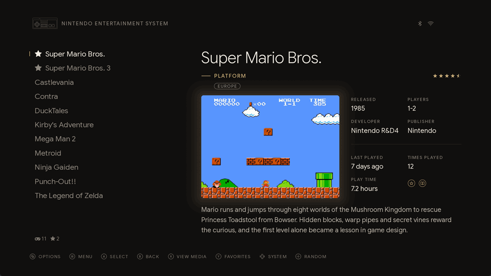
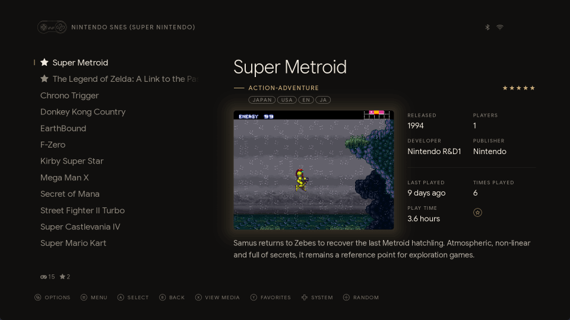
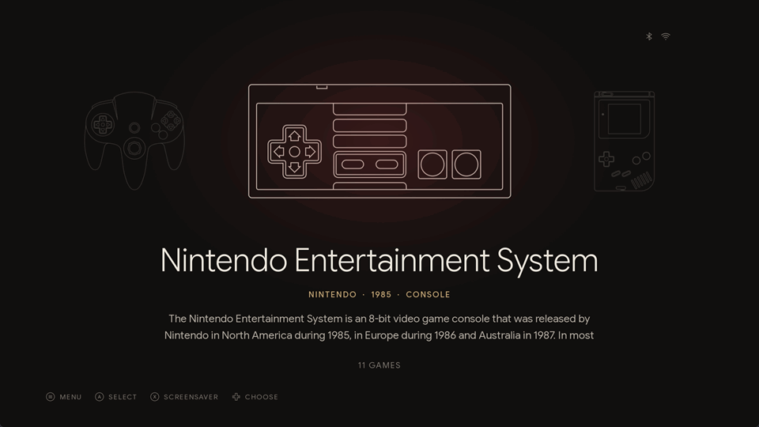
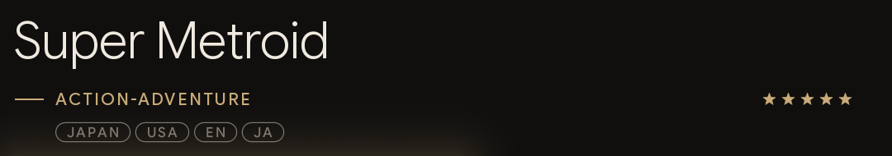
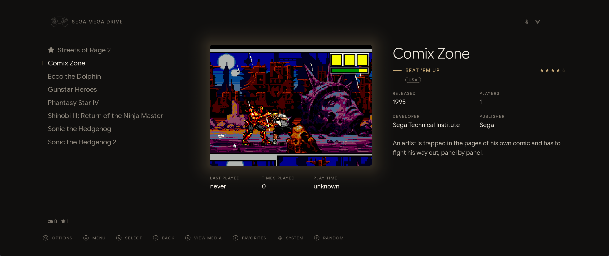
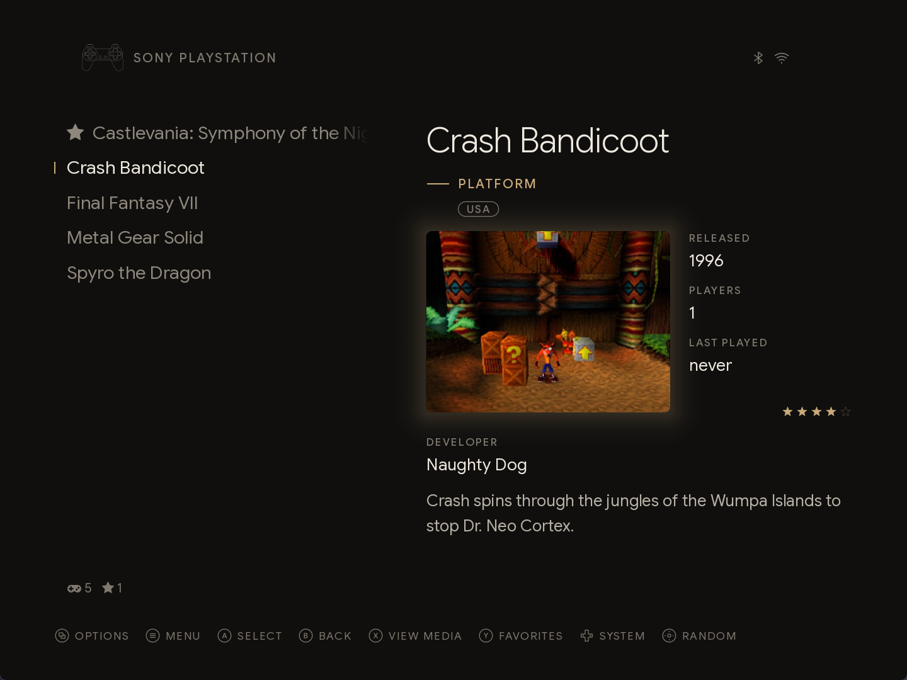
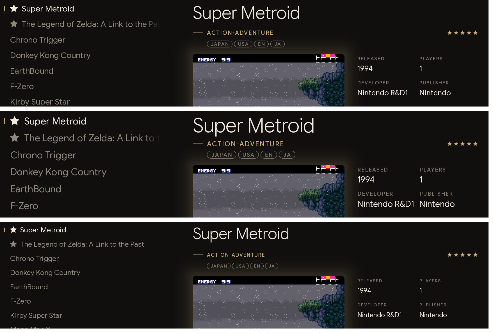

# Atelier for ES-DE


**A quiet, modern theme for [ES-DE](https://es-de.org).** Atelier treats your game library the way a good book treats its pages: generous margins, careful type, and nothing on screen that doesn't need to be there. Systems are introduced by fine line drawings of their controllers, game lists read like the index of a book, and a single warm accent marks whatever deserves your attention. Everything is set in Google Sans Flex, with tracked capitals for the small labels.

It comes with two companions in the same design, both opened from the system carousel: **Retro Achievements**, a trophy room for your progress on [RetroAchievements](https://retroachievements.org), and **Catalogue**, which keeps your games on a network or USB disk, brings them back whenever you like and gathers them in collections of your own.

**ES-DE 3.0 or newer** · 4 layouts in 7 variants · 8 color schemes · 4 screen shapes · 23 languages · controller drawings for over 200 systems and collections · Retro Achievements · Catalogue

## Contents

| [The theme](#the-theme) | [Retro Achievements](#retro-achievements) | [Catalogue](#catalogue) |
| :-- | :-- | :-- |
| [Highlights](#highlights) | [How it works](#how-retro-achievements-works) | [How it works](#how-catalogue-works) |
| [The system view](#the-system-view) | [Your library](#your-library) | [The Catalogue mode](#the-catalogue-mode) |
| [Layouts](#layouts) | [Three ways to look at it](#three-ways-to-look-at-it) | [Archiving and bringing back](#archiving-and-bringing-back) |
| [Color schemes](#color-schemes) | [The wall of badges](#the-wall-of-badges) | [Saves](#saves) |
| [File name tags](#file-name-tags) | [Your progress in ES-DE](#your-progress-in-es-de) | [The Collections mode](#the-collections-mode) |
| [Every screen](#every-screen) | [Controls](#controls-in-retro-achievements) | [Collections in ES-DE](#collections-in-es-de) |
| [Languages](#languages) | [Setting it up](#setting-up-retro-achievements) | [The archive on the disk](#the-archive-on-the-disk) |
| [Sounds](#sounds) | | [Controls](#controls-in-catalogue) |
| [Settings](#settings) | | [Setting it up](#setting-up-catalogue) |

**And for everyone:** [Installation](#installation) · [Tips](#tips) · [Credits](#credits)

## The theme

Everything ES-DE shows itself: the system carousel, the game lists, the colors, the type and the sounds.

### Highlights

- **Four layouts in seven variants:** Index, with or without videos and in a compact form, Typographic, Gallery and Grid, each drawn by hand for 21:9, 16:9, 16:10 and 4:3
- **Two ways to choose a system:** the carousel of controller drawings, or a list of your systems beside a page about the one you're on
- **Eight color schemes:** Noir, Ivory, Midnight and OLED, each also in an *atmosphere* version that takes on the color of the console
- **File name tags:** region, languages and revision, read straight from your ROM file names and shown as small tags, with nothing to scrape
- **A clean Collections system:** a page of its own for your custom collections, without random games or videos playing
- **Soft navigation sounds**, tuned to each other
- **23 languages** for labels and system descriptions
- **Graceful without scraping:** systems with no media switch to a purely typographic page, so even an empty library looks intentional

Developed and tested on ES-DE 3.5.

### The system view

Every system gets a proper introduction. Its controller sits large in the middle of the carousel, drawn in a single fine line, with its neighbors dimmed on either side. Beneath it you'll find the name of the system, a caption with its maker, year and kind (*Nintendo · 1990 · Console*), a few lines of its history and the number of games you have. With the *soft* transitions the text fades while the drawings slide on.


The drawings come from ES-DE's own outline set and cover nearly every system it knows, from the Atari 2600 to the Switch, collections included; the few without one get a neutral folder. When several systems share a drawing, such as the Amiga models, the CD and regional versions of a console or the many arcade boards, a small tag in the corner names the model (*AMIGA 1200*, *MEGA-CD*, *NAOMI 2*), so no two systems in the carousel look alike. The same drawing follows you into the header of the game list.

Would you rather read the neighbors too? Every variant also comes as *· names* (*Index · names*, *Grid · names* and so on, under *UI settings → Theme variant*). Each system in the carousel then has its name beneath its drawing, about a third the size of the title, and the neighbors are a little brighter so that you can read them. With the *soft* transitions the name grows as a system reaches the middle, then gives way to the title. The game lists stay exactly the same.


The names are part of the drawings, so they keep their size whatever the font size, and they are the ones ES-DE gives its systems: a system you renamed yourself keeps its original name there. They replace the tags too, except for the few systems that have the same name in ES-DE, such as the Japanese Mega Drive. Custom collections shown as systems of their own have a folder without a name, and so have ES-DE's own collections (*Favorites*, *All Games*, *Last Played*, *Collections*) in languages whose letters the font doesn't have: Russian, Japanese, Korean, Chinese and Arabic.

Or would you rather see your systems one under the other? Every variant also comes as *· list* (*Index · list*, *Grid · list* and so on). The carousel then gives way to a list of your systems on the left, in the same place, type and size as the list of games in the Index, with the same small accent beside the one you're on. The right of the page tells you about it: its drawing, its name, the caption beside a short rule, its history and the number of games. Its year of release is set large and faint behind the drawing. Collections and the Retro Achievements and Catalogue entries have no year there. With the Index variants, opening a system feels like turning a page: the list of systems becomes the list of its games, in the same place.


A list can't slide or fade the way the carousel does, so between systems the *· list* variants change the page at once, as the details do when you move through a game list. That happens on its own while *Theme transitions* is left on *Automatic*, as it is unless you change it. If you pick *Soft* yourself, ES-DE darkens the page for a moment at every step, which shows most on Ivory. *Slide* turns the page up or down with the list, and *Instant* changes it at once, as it does everywhere else.

### Layouts

Four ways to browse your games, all sharing the same calm grid, and the Index comes in four variants. Pick one under *UI settings → Theme variant*.

#### Index



The classic: your game list beside a rounded media card lit by a soft glow, where the screenshot gently gives way to the game video, with the facts and your play statistics alongside. The title stands on one line level with the top of the list, so the description below gets four lines on a 16:9 screen; a longer title scrolls sideways. *Index, no videos* keeps the still image, if you prefer a quieter screen.

Do you read the descriptions? *Index, compact* leaves out the large title, which the list beside it already shows, moves everything else up and gives the description the room: six lines instead of four on a 16:9 screen. It also comes without videos.

#### Typographic


No media at all: the title carries the page. The Index layouts switch to it on their own for systems you haven't scraped yet, so an unscraped library still looks deliberate rather than empty. *Enable theme variant triggers* in the UI settings turns this off.

#### Gallery


A shelf of box covers with the selected title set beneath it, sized for the shape of each console's boxes. Games without a cover still get one, made of type.

#### Grid


Box covers in rows across the left of the page, and beside them the title, genre and description, then the media card with the facts. The selected cover is lit by the same glow as the media card.

### Color schemes



| Scheme | Page | Accent | Feel |
| :-- | :-- | :-- | :-- |
| **Noir** | warm black | champagne | the default, soft and warm |
| **Ivory** | paper | bronze ink | a printed page; the glows become soft shadows |
| **Midnight** | deep navy | gold | cool and calm |
| **OLED** | true black | champagne | for OLED screens, nothing lit that needn't be |

Pick one under *UI settings → Theme color scheme*. Retro Achievements and Catalogue follow the scheme you choose.

#### Atmosphere



Each scheme also comes in an *atmosphere* version, for evenings when you want a little more mood. A soft room light in the color of the console glows behind its drawing, the light around the game media and the selected cover takes the same color, and the game lists rest on a faint, desaturated copy of the selected game's fanart (or screenshot).

### File name tags



ROM sets keep useful details in brackets in the file name: region, languages, revision, disc, dump flags. Atelier shows each of them as a small tag on a line of their own beneath the genre, so `Super Metroid (Japan, USA) (En,Ja).sfc` reads JAPAN · USA · EN · JA. Parts in parentheses get rounded tags, parts in square brackets such as `[!]` square ones, and a file without any shows nothing. There is nothing to scrape or set up.

How does a theme pull that off? ES-DE only hands it the file name as a whole, so the tags are drawn by a font of their own. Every character in it is an empty glyph by default, and contextual substitutions, which ES-DE applies while laying out the text, make a bracket start a tag, keep the characters after it visible and split the tag at each comma.

### Every screen

<table>
  <tr>
    <td></td>
    <td></td>
  </tr>
  <tr>
    <td align="center">21:9</td>
    <td align="center">4:3</td>
  </tr>
</table>

Whatever you play on, from an ultrawide monitor to an old 4:3 television, Atelier has a layout drawn for it. Every layout exists for 21:9, 16:9, 16:10 and 4:3, and the right one is picked automatically; *UI settings → Theme aspect ratio* can force one.



Three font sizes, from the top: **medium**, **large**, for a television seen from the sofa, and **small**, for a monitor at arm's length. Pick one under *UI settings → Theme font size*.

A fourth, **extra large**, is for small screens held in the hand, such as a 4" handheld. It enlarges what is smallest elsewhere: the clock, the system status, the header, the genre, the game count, the file tags and the help prompts, and a little the game list. The rest stays as in *large*.

Whatever the size, what you need to read is never cut short with an ellipsis. On 4:3 screens, which are mostly handhelds, a title in the Grid takes up to three lines, the genre spans the whole column, the stars have a line of their own beneath the badges, and the developer has a line of its own under the picture; a genre, developer or system name that is still too long scrolls sideways, as the Gallery title does.

### Languages


Labels, captions and the history of every system come in 23 languages: English (US and UK), Arabic, Bosnian, Catalan, Chinese (simplified and traditional), Croatian, Dutch, French, German, Italian, Japanese, Korean, Polish, Portuguese (Brazil and Portugal), Romanian, Russian, Serbian, Spanish, Swedish and Vietnamese. Atelier follows the language of ES-DE, or the one chosen under *UI settings → Theme language*.

### Sounds

Seven soft navigation sounds, tuned to one another in E major with a little room around them, replace the ES-DE defaults while *Navigation sounds* is enabled in the sound settings. Have a listen: [scroll](core/sounds/scroll.wav), [system browse](core/sounds/systembrowse.wav), [quick system select](core/sounds/quicksysselect.wav), [select](core/sounds/select.wav), [back](core/sounds/back.wav), [favorite](core/sounds/favorite.wav) and [launch](core/sounds/launch.wav). Retro Achievements and Catalogue use them too.

### Settings

Everything below is in ES-DE's *UI settings* menu.

| Setting | Choices |
| :-- | :-- |
| Theme | Atelier |
| Theme variant | Index · Index, no videos · Index, compact · Index, compact, no videos · Typographic · Gallery · Grid, each also as *· names* and *· list* |
| Theme color scheme | Noir · Ivory · Midnight · OLED, each also as *· atmosphere* |
| Theme font size | Medium · Large · Small · Extra large |
| Theme aspect ratio | Automatic · 21:9 · 16:9 · 16:10 · 4:3 |
| Theme transitions | Soft (default) · Slide · Instant; leave it on *Automatic* for the *· list* variants |
| Theme language | Automatic, or any of the 23 languages |
| Enable theme variant triggers | On: systems without scraped media use Typographic |

## Retro Achievements


If you hunt achievements on [RetroAchievements](https://retroachievements.org), Atelier gives you a trophy room that feels like part of ES-DE. Pick *Retro Achievements* in the system carousel (it comes after your systems) and every game you own that has achievements is there: how far you've come, which badges you've earned, and which one you're most likely to earn next. Press B and you're back in ES-DE, right where you left it.

The app wears the theme you chose: the same color scheme, font size, aspect ratio, sounds and help icons. It works with a controller or the keyboard.

### How Retro Achievements works

1. **It finds your games.** It goes through the systems ES-DE knows and recognizes each game by the hash of its file, the way RetroArch does, so it knows exactly which version of a game you have. Disc images aren't hashed yet: for those it goes by the title.
2. **It asks the site.** With your username and Web API key it fetches, every time it opens, what you've unlocked, your points, your play time and the badges of each game. After a play session the new badges are already waiting for you. When the site can't be reached, it shows what it saw last.
3. **You look around.** Your games sit on shelves, one per platform; **A** opens the wall of badges of a game, **Start** the options, **B** goes back.
4. **ES-DE can show it too,** if you like: your progress in the details of every game, without opening the app.

The app talks to nobody but RetroAchievements: it runs on your computer and closes with its window.

### Your library

Your games sit on one shelf of covers per platform, with a progress bar under each cover. Games you're in the middle of get a shelf of their own at the top, *Continue playing*, so picking up where you left off is one button away. Above the shelves, a bar shows how far you've come overall; switch the filter with **LB** and **RB** (all, in progress, not started, completed) and it shows the progress of just those games.

Beside the shelves, the selected game tells its story: achievements and points earned, your play time and hardcore unlocks as RetroAchievements counts them, and under *Next* the locked achievement most players already have, a good place to start. If your file is a version RetroAchievements doesn't recognize, such as a region or revision other than the supported ones, the app says so (*This version of the game unlocks nothing*) and lists the versions it does support, because RetroArch won't unlock anything with it.

### Three ways to look at it

Press **Start** for the options, just as in ES-DE, and choose how the library looks. The change happens behind the menu as you scroll through the choices, and the app remembers it next time.

<table>
  <tr>
    <td></td>
    <td></td>
    <td></td>
  </tr>
  <tr>
    <td align="center"><b>Grid</b><br>shelves of covers</td>
    <td align="center"><b>Titles</b><br>just the names, like a game list</td>
    <td align="center"><b>Titles & cover</b><br>each name with its box and progress</td>
  </tr>
</table>

The same menu also sorts the library (latest unlocks, progress, name; **Y** does it too), filters it, signs you in again under *Account*, and takes you back to ES-DE.

### The wall of badges


Press **A** on a game and its badges fill the page: the ones you've earned in full color, the rest in grey. For the selected badge you see what it asks of you, its points, when you earned it and how rare it is among players. Press **Y** to see only the badges still to unlock, the most common first, or only the ones you've earned, the latest first. **LB** and **RB** move to the previous or next game on the shelf without leaving the wall.

### Your progress in ES-DE


Would you like to see your progress without opening the app? Then let it appear in ES-DE itself, in the details of every game that has achievements: how many you've unlocked out of the total, a slim bar and the percentage, in the accent color of your scheme.

- **Retro Achievements - Enable Progress Bar in ES-DE.cmd** draws it for all your games. From then on the app keeps it up to date each time it opens, and ES-DE shows the new figures after a restart.
- **Retro Achievements - Disable Progress Bar in ES-DE.cmd** removes it again.

ES-DE has no field for this, so the progress is an image that takes the place of each game's physical media image, which Atelier shows nowhere else, and the theme shows it only while the progress is enabled. Your own physical media images, including any you scrape later, wait in `ES-DE/atelier/physicalmedia-backup` and come back when you disable it.

### Controls in Retro Achievements

| | Library | Wall of badges |
| :-- | :-- | :-- |
| **D-pad** | move between games | move between badges |
| **A** | open the game's badges | |
| **B** | back to ES-DE | back to the library |
| **LB / RB** | filter: all, in progress, not started, completed | previous / next game on the shelf |
| **LT / RT** | to the top / the bottom of the library | |
| **Y** | sort: latest unlocks, progress, name | view: set order, still to unlock, unlocked |
| **Start** | options, account | options, account |

On a keyboard, as in ES-DE: Enter is A, Backspace is B, Escape is Start, Page Up and Page Down are LB and RB, Home and End are LT and RT, and the Y key is Y.

### Setting up Retro Achievements

The app needs only Windows, as [Installation](#installation) explains.

1. Run **Retro Achievements - Install.cmd** in the theme's `scripts/runnable/windows` folder. It asks nothing: it adds *Retro Achievements* to the system carousel and closes by itself.
2. Restart ES-DE and open *Retro Achievements*. The first time, it asks you to sign in: your username is already there when RetroArch is signed in to RetroAchievements, and you add your *Web API Key*, which is on retroachievements.org under *Settings*, *Keys*. Type it on the on-screen keyboard, or on a keyboard, where Ctrl+V pastes it. The app checks it with the site and keeps it.

RetroArch keeps your username and a login token, but not the Web API key, which is the only key the site's web service takes; that is why the key is asked for once. *Start → Account* signs in again or as someone else. You can run **Retro Achievements - Install.cmd** again at any time, for example after moving the theme folder; the saved username and key stay. **Retro Achievements - Uninstall.cmd** takes Retro Achievements out of ES-DE again, together with the progress above, the saved username, key and cache.

<details>
<summary>Good to know</summary>

- **Your key stays yours.** The username, key and cache live in `ES-DE/atelier/achievements`, outside the theme folder, so updating the theme keeps them and the key never ends up in a copy of the theme.
- **The carousel entry** is added to `ES-DE/custom_systems/es_systems.xml` (a file you already had is backed up once as `es_systems.xml.atelier-backup`), with its game list in `ES-DE/gamelists/retroachievements`.

</details>

## Catalogue


Want your games somewhere safe, or on more than one machine? Catalogue keeps them in an archive on a network disk or a USB disk, one zip file per game together with its details and media, and brings them back into this ES-DE or any other. Pick a game that only the archive has, and moments later it is in its system's ROM folder with its cover, screenshots, description and the rest, as if it had always been there. It also gathers your games in collections of your own, whatever they run on and wherever they are.

Pick *Catalogue* in the system carousel; it comes after your systems. Like Retro Achievements, it wears the theme you chose, works with a controller or the keyboard, and B takes you back to ES-DE. [Setting up Catalogue](#setting-up-catalogue) takes you through the first time, step by step.

### How Catalogue works

Catalogue looks at two places side by side:

| | **ES-DE** | **The archive** |
| :-- | :-- | :-- |
| **Where** | this computer | a folder on a network or USB disk, which every computer can use |
| **What it holds** | the games you play here, with their details and media | one zip per game with its details and media, the saves, the collections |

Nothing moves by itself: you choose what to archive, what to bring back and what to remove, and the transfers run in the background while you keep browsing.

The app has two modes, each a page of its own:


- **Catalogue** is where games go into the archive and come back from it, platform by platform, with their saves.
- **Collections** is where you make your collections and fill them, by hand or with a search.

Press **Select** (View on Xbox, − on Switch, Create or Share on PlayStation, Tab on a keyboard) to choose between them: the two modes appear side by side with the other one already chosen, so Select and then A takes you straight across. The header names the mode you are in and, next to the Select icon, the other one. Each mode is just as you left it when you come back, the app always opens in the Catalogue, and B from the top of either mode goes back to ES-DE.

### The Catalogue mode

#### Three sections


The Catalogue has three sections, named on the line at the top with how many games each has. **LB** and **RB** go from one to the next, and the Catalogue opens on the one you used last:

| Section | What it shows |
| :-- | :-- |
| **Archive** | everything the archive holds, whether this ES-DE has it or not: the whole archive, to browse from end to end |
| **In ES-DE** | the games installed here, archived or not |
| **Not archived** | the games of ES-DE that were never archived, the ones to put in the archive |

Each section lists its platforms, with their drawing and how many of their games it has, and the corner names the archive in use. Beside the list, the chosen platform says how many of its games are in the archive, in ES-DE, not archived and to install. Press **A** to open a platform, and **B** takes you back to the platforms.

Inside a platform, a line and its bar beneath the sections tell how its games stand: in the Archive, how many are installed and how many are left to install; in ES-DE, how many are archived as they are, how many are to sync and how many aren't archived. Each line ends with how much the games take, then their media apart: the size of a game is only its own files. A line too long for its place scrolls sideways. Not archived has this line over all the platforms too, with how much there is to archive.

<table>
  <tr>
    <td></td>
    <td></td>
    <td></td>
  </tr>
  <tr>
    <td align="center"><b>Archive</b>: everything it holds</td>
    <td align="center"><b>In ES-DE</b>: what is installed here</td>
    <td align="center"><b>Not archived</b>: what to archive</td>
  </tr>
</table>

#### How a game stands

A platform's games fill the page as a grid of covers, or as a list of titles with or without covers (*Start → View*), sorted by name, by size or by when they were archived (*Start → Sort by*). An icon at the corner of each cover, and before its state in the lists, tells how the game stands; what asks for something of you is in the accent:


| Icon | The game is |
| :-- | :-- |
| a play sign: **Installed** | in ES-DE and in the archive, the same |
| two turning arrows, in the accent: **To sync** | in both, but changed in ES-DE since it was archived: other files, or new details or media after scraping |
| an arrow up, on a disc in the accent: **Not archived** | in ES-DE only: archive it to keep it safe |
| an arrow down, with a paler cover: **To install** | in the archive only, ready to download |
| a dash: **Can't be installed** | in the archive only, of a system this ES-DE doesn't have |

While a game is archived or downloaded, a line beneath its cover grows with the transfer. Beside the covers the selected game says the same in words, after its icon, with its size and the size of its zip, the size of its media (ES-DE's, or the archive's for a game only there), when and from which computer it was archived, and how its saves stand. Rest on a game and, as in ES-DE, its screenshot gives way to its video, with the sound and volume ES-DE plays its game list videos with; a game only in the archive plays the video archived with it.

#### Archiving and bringing back

<table>
  <tr>
    <td></td>
    <td></td>
  </tr>
  <tr>
    <td align="center"><b>A</b> on a game</td>
    <td align="center"><b>Y</b> on a platform</td>
  </tr>
</table>

On a game, press **A** for what can be done with it, and only that: archive it (or its newer version), update its details in the archive, download it to ES-DE or replace ES-DE's copy with the archive's, upload or download its saves, remove it from ES-DE or from the archive. The choices that move files say how much: the games, then the media of the kinds that travel. A choice too long for the menu scrolls sideways while it is selected, as a game's name does in ES-DE. Mark several games with **X** and **A** acts on all of them; **Y**, on a platform or among its games, acts on the platform's games in the section, such as *Archive the games not archived*, *Archive the new and changed games*, *Update details in the archive* or *Download what ES-DE lacks*, and can mark them all.

Changes go one way: the archive's folder is never edited by hand, so only ES-DE's copy of a game changes, and archiving it again brings the archive up to date. After you scrape a game again or change its details in ES-DE, it turns *To sync*, and *Update details in the archive* brings the new details and media across and leaves the game's zip as it is. None of this is ever done by itself.

#### Transfers


Transfers run one after the other while you keep browsing, even in the other mode. The line under the sections says what is happening (the game, the step, how many are left) and its bar follows along; when they are all done, a small card with a tick says so on the header line, with the games, and their covers light up for a moment. *Start → Stop transfers* ends them.

Nothing is ever left half done: a zip is written next to its place, read back and only then put in place, and a download is extracted aside and checked file by file against what was archived before its files move into the ROM folder. Removing asks first, and a game that isn't in the archive as it is in ES-DE gets a warning and the offer to archive it first.

ES-DE reads its games and collections only when it starts, so when you leave after downloading or removing games, or after changing a collection, Catalogue restarts ES-DE for you: it closes the way its window would, saving what it must, and opens again right away with your library as it is now, on its first system as at every start. Run without ES-DE, the app tells you to restart it instead.

#### Saves

The saves and save states RetroArch keeps of a game can go to the archive too. A game has one copy of them, shared by everyone who uses the archive. Upload them after playing, download them on another computer, and carry on where you left off: they land where that computer's RetroArch looks for them, whether it sorts its saves by core, by ROM folder or not at all.

Beside each game, *Saves* tells how they stand: none, only here, in the archive, in sync, newer here, newer in the archive, or changed on both. Every upload keeps the five before it in the archive's history, and a download first copies the saves it replaces to `ES-DE/atelier/catalogue/saves-backup`. When the same game was saved on two computers since they last met, the app tells you and lets you choose which to keep. Save states only load in the core that made them, so they keep its folder; in-game saves follow the core each computer uses. Removing a game leaves its saves where they are.

#### What goes along

*Start → Media to archive* and *Media to download* choose the kinds of media that travel, each with its size: covers, screenshots, fan art, manuals, videos and the rest. On a small handheld, for example, the videos can stay in the archive. The details (name, description, dates, developer, publisher, genre, players, rating) always go along; your favorites, play counts and other personal fields stay where they are.

### The Collections mode

Gather your games in collections of your own, whatever they run on and wherever they are: a saga across five consoles, the games for the kids, the ones to play with friends on the sofa. A collection names its games; it doesn't copy them, so a game can be in as many collections as you like.

#### Making a collection


Press **Select** and choose *Collections*: the list of your collections opens, each with how many games it has and how many of them are in ES-DE, and its first row makes a new one. Press **A** on *New collection…*, type its name on the on-screen keyboard and press **Start**: you are straight in the search, with every game in view.

#### Finding games

<table>
  <tr>
    <td></td>
    <td></td>
  </tr>
  <tr>
    <td align="center">the games found, a tick on those already in</td>
    <td align="center"><b>X</b>: filters, add all, keep up to date</td>
  </tr>
</table>

The search looks through what Catalogue knows about your games, in ES-DE and in the archive alike: names, file names with their regions and languages, platforms, developers, publishers, genres, years and descriptions. **Y** opens the on-screen keyboard for a few words, and it counts the games found as you type. Narrow them down with **X**: platform, genre, decade, year, developer, publisher, players, region, favorites, completed. **LB** and **RB** keep to the games in ES-DE or to those only in the archive.

Then press **A** on a game to put it in the collection, or to take it out again; a tick marks the games that are in. The same menu adds every game found at once. **B** takes you back to the collection.

#### Collections that keep up

A collection can also keep itself up to date. In the search menu, *Keep the collection up to date with this search* makes it hold whatever the search finds, now and after you add or download more games, on every computer that uses the archive; a game you take out of it stays out. The list marks these collections *Keeps itself up to date* and says what they keep up with, such as *2 or more* players for a couch co-op collection. *Change its search…*, in the collection's menu, opens the search again, where *Stop keeping it up to date* makes it an ordinary collection.

#### Inside a collection


Inside a collection, its first tile adds games, and each game carries the same icon as in the Catalogue. Games only in the archive have a paler cover with an arrow down at its corner, and LB and RB show just those to install. A game you add that is only in ES-DE is archived along with it, after asking, so that the collection is whole on every computer.

**Y** opens the collection's menu, which offers what it needs: download its games to install, archive those a search found that are only in ES-DE, take out those no longer anywhere, rename the collection or delete it. Deleting a collection deletes nothing else: its games stay in the archive and in ES-DE.

**A** on a game offers only what the collection needs of it: download it, archive it, take it out, or *Open in the Catalogue*, which takes you to it among the games of its platform for everything else, such as its saves or removing it.

#### Collections in ES-DE


When you leave the app, ES-DE shows your collections in its *Collections* system, with the games it has; the others join as soon as you download them. Atelier gives that system a page of its own. The list of collections stays clean, without a random game, its description or the sound of its video: the name of the selected collection is set large and faint behind it. Inside a collection the header shows its name, with the platform of the selected game beneath it, and the games are grouped by platform.

<details>
<summary>What changes in ES-DE</summary>

Each collection becomes a custom collection of ES-DE, `ES-DE/collections/custom-<name>.cfg`, enabled in its settings; with *Group custom collections* set to *If unthemed*, as ES-DE comes, or *Always*, they appear inside the *Collections* system. Catalogue writes them while ES-DE is closed, as it restarts it, and only ever touches the collections it made. Games you add or take out with ES-DE's own collection editor are carried into the archive the next time Catalogue opens.

The games of every custom collection, yours included, get one field in the gamelists, the collection sort name, which ES-DE only uses inside custom collections; each gamelist is backed up once as `gamelist.xml.atelier-backup`. **Catalogue - Uninstall.cmd** takes all of it out again.

</details>

### The archive on the disk

```
<your folder>\
  @metadata\
    archive.json
    nes\
      system.json             the system's name
      catalog\00.json … ff.json   what the archive holds of the system's games
      gamelist.xml            their details, in ES-DE's format
      covers\  screenshots\  manuals\  videos\  …
  @saves\
    nes\Super Mario Bros. (Europe)\current\, history\
  @collections\
    For the kids.json         a collection: its games by system and file, or its search
  nes\
    Super Mario Bros. (Europe).zip
  snes\
    …
```

Each zip holds exactly the files of the game as they were in the ROM folder, so it opens in File Explorer or with any zip tool too: a single file, a cue sheet with its tracks, a playlist with its discs, or a whole folder that ES-DE treats as a game. Files that are compressed already, such as the zip of an arcade set or a CHD, are stored as they are. Subfolders of the ROM folder are kept.

A system's catalog is split into 256 small files, each game in one of them, so that a transfer rewrites one small file however many games the system has. The `gamelist.xml` beside it, there so that the archive reads in ES-DE's format without the app too, is written again as you leave the app, for the systems that changed.

#### What makes up a game

A game is more than the file ES-DE lists, so Catalogue archives everything it needs, whichever extensions you show in ES-DE:

- **What its file names:** the tracks of a cue sheet or a GD-ROM list, the discs of a playlist, the image of a CloneCD or Alcohol descriptor. Old cue sheets not written in UTF-8 are read too, and a file named with a path that no longer exists is looked for beside the sheet.
- **Files with the same name beside it:** `MediEvil (Europe).cue` takes `MediEvil (Europe).sbi` and, if ES-DE doesn't list it, `MediEvil (Europe).chd`. What ES-DE lists stays a game of its own, and saves stay out: they have [their own place](#saves).
- **A folder with the same name, with no other game in it:** the CHD of an arcade set, as in `kinst.zip` and `kinst\kinst.chd`.
- **All of its folder, for a program:** in DOS, PC and ScummVM, a `.exe`, `.bat`, `.com`, `.conf`, `.svm` or `.scummvm` in a subfolder takes everything that subfolder holds, as `Doom\DOOM.EXE` takes all of `Doom`.

A game that names a file that isn't there is not archived: the transfer fails and says which file is missing, so that an incomplete game never looks safe. A file two games share is removed from ES-DE with the last of them.

BIOS files and the parent sets of arcade clones are not part of a game for now. Those ES-DE lists are games of their own, so archive them too; the rest, such as the BIOS files in an emulator's folder, stay out of the archive.

### Controls in Catalogue

| | Platforms | A platform's games | Menus and dialogs | Folder chooser |
| :-- | :-- | :-- | :-- | :-- |
| **D-pad** | choose a platform | move between games | choose, left and right change a value | choose |
| **A** | open its games | actions for the game, or the marked games | select | open |
| **B** | back to ES-DE | back to the platforms | close | up a folder |
| **X** | | mark or unmark the game | | |
| **Y** | actions for the platform | actions for the platform | | use this folder |
| **LB / RB** | section: archive, in ES-DE, not archived | section | | |
| **LT / RT** | first / last platform | first / last game | | first / last folder |
| **Select** | choose the mode | choose the mode | close the choice of mode | |
| **Start** | options | options | close the options | options |

| | Collections | A collection | Its search |
| :-- | :-- | :-- | :-- |
| **D-pad** | choose a collection | move between games | move between games |
| **A** | open it, or make a new one | add games (first tile), actions for the game | put the game in or take it out |
| **B** | back to ES-DE | back to the collections | back to the collection |
| **X** | | mark or unmark the game | filters, add all, keep up to date |
| **Y** | actions for the collection | actions for the collection | type the search |
| **LB / RB** | | all, in ES-DE, to install | all, in ES-DE, archive only |
| **LT / RT** | first / last collection | first / last game | first / last game |
| **Select** | choose the mode | choose the mode | choose the mode |
| **Start** | options | options | options |

The on-screen keyboard, for an address, a name, a search or a password, takes A for a key, X to erase, Y for a space and Start when done. On a keyboard, type straight into it; elsewhere, as in ES-DE, Enter is A, Backspace is B, Escape is Start, Page Up and Page Down are LB and RB, Home and End are LT and RT, the X and Y keys are X and Y, and Tab is Select.

### Setting up Catalogue

The app needs only Windows, as [Installation](#installation) explains: the zip files are made with what comes with it, so there is no 7-Zip or other program to install.

1. Run **Catalogue - Install.cmd** in the theme's `scripts/runnable/windows` folder. It asks nothing and downloads nothing: it adds *Catalogue* to the system carousel and closes by itself. Then restart ES-DE.
2. Pick *Catalogue* in the carousel. There is no archive yet, so press **A** and choose a folder on a USB disk or a network drive, or type a network address such as `\\NAS\games`. **Y** uses the folder you are in, and a folder without an archive becomes one when you say so.
3. Press **RB** until *Not archived*, which lists the games of ES-DE the archive doesn't have yet. On a platform, press **Y** and choose *Archive the games not archived*: its games go into the archive one after the other.
4. On another computer, install Catalogue the same way and choose the same folder. The *Archive* section shows everything in it, and the games this ES-DE lacks carry an arrow down: on a platform, **Y** and *Download what ES-DE lacks*.
5. Press **B** to leave. ES-DE restarts by itself, and the games you downloaded are in it.

When a network share asks for a user name and password, the app asks for them and hands them to Windows, which can remember them in its Credential Manager, as File Explorer does; the app keeps no password of its own. More than one archive can be kept, such as a NAS and a USB disk, and switched in the options.

**Catalogue - Uninstall.cmd** takes it out of ES-DE again with its settings and its collections; your archives, the collections in them, your games and saves stay as they are. Close ES-DE before running it if you made collections.

<details>
<summary>Good to know</summary>

- **Atelier's own images stay out of the archive.** The achievement progress is drawn by Atelier into the physical media folder; the archive gets your own images, which wait in `ES-DE/atelier` meanwhile.
- **Games are told apart** by their system and their path in the ROM folder, and compared by size and date, then by CRC when the dates differ. Collections name their games the same way, so a game is the same one on every computer.
- **Collections belong to the archive:** everyone who uses it sees them. Each computer shows the games of a collection it has, and a collection that keeps itself up to date finds the games of each computer.
- **The settings** (the archives, the media chosen) are in `ES-DE/atelier/catalogue`, with what the collections are in ES-DE, and gamelists Catalogue changes are backed up once as `gamelist.xml.atelier-backup`.
- **Large libraries** stay quick, even hundreds of thousands of games in a single system with the archive on a NAS: the app shows the games a page at a time and keeps a copy of what it read of the archive, of ES-DE's large gamelists and of the cue sheets of a large system in `ES-DE/atelier/catalogue/cache`, so that a start reads again only what changed since. The copy can be deleted at any time; the next start makes it again.
- **Saves** are exchanged for the games RetroArch runs; the cores' own folders for other systems, such as Dolphin's or PCSX2's memory cards, are not covered yet.

</details>

## Installation

Copy the `atelier-es-de` folder into the ES-DE themes directory and select *Atelier* under *UI settings → Theme*:

- Windows portable: `ES-DE\ES-DE\themes\`
- Windows installer, Linux, macOS: `~/ES-DE/themes/`

Retro Achievements and Catalogue are optional: the theme works without them, and each is added with its own setup script ([Retro Achievements](#setting-up-retro-achievements), [Catalogue](#setting-up-catalogue)). They are for Windows only for now, and they need nothing else: they run with Windows PowerShell in a full-screen window of Microsoft Edge, both part of Windows (Google Chrome works too), so there is nothing to install. Their own words are in English and Italian for now; the rest follows the theme.

To update, replace the folder with the new one. If you use Retro Achievements or Catalogue and the folder's name or place changed, run **Retro Achievements - Install.cmd** or **Catalogue - Install.cmd** again, and if you show the achievement progress in ES-DE, open the app once so that it comes back.

To uninstall, first run **Retro Achievements - Uninstall.cmd** if you installed Retro Achievements and **Catalogue - Uninstall.cmd** if you installed Catalogue, so that your own physical media images are put back and your collections leave ES-DE; then delete the folder.

## Tips

- **Scrape screenshots and covers.** They bring the Index, Gallery and Grid layouts to life: videos fade in over the screenshot when you pause on a game, and fanart feeds the atmosphere schemes. Screenshots are preferred over miximages, as they sit more calmly in the frame.
- **On a television,** choose the *large* font size; **on a small handheld,** *extra large*, with the compact Index for longer descriptions.
- **For OLED screens,** the *OLED* scheme keeps the page truly black.
- **Keep the file names of your ROM sets.** The tags come straight from them: `(USA, Europe)`, `(Rev 1)`, `(Disc 2)`.
- **After scraping new games,** open Catalogue once: the collections that keep themselves up to date take them in, and *Update details in the archive* brings the new media to your other computers.
- **Chasing achievements?** Play the versions RetroAchievements supports: the app tells you when a file isn't one of them, and which ones are.

## Credits

The typefaces, controller drawings and system texts are credited in [CREDITS.md](CREDITS.md). Atelier is released under the [MIT license](LICENSE).

The screenshots show box art and game screenshots from the [libretro thumbnail collection](https://github.com/libretro-thumbnails/libretro-thumbnails), and videos and fanart scraped from [ScreenScraper](https://www.screenscraper.fr). The Retro Achievements screenshots show achievement data and badges from [RetroAchievements](https://retroachievements.org). The games and their artwork belong to their respective owners.
